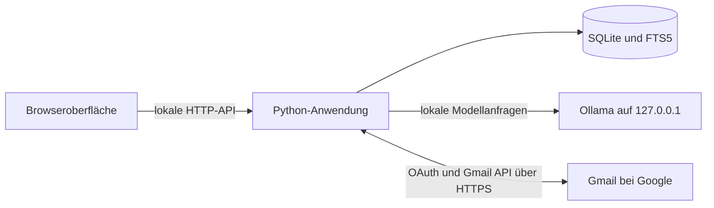

# AI Mail Responder – Projektdokumentation

Stand: 9. November 2026. Diese Dokumentation beschreibt die Python-Implementierung im Repository und soll die Einrichtung, Nutzung und Weiterentwicklung ohne vorherige Projektkenntnis ermöglichen.

## Inhalt

1. [Ziel und Funktionsumfang](#1-ziel-und-funktionsumfang)
2. [Installation und Start](#2-installation-und-start)
3. [Gmail einrichten](#3-gmail-einrichten)
4. [Bedienung](#4-bedienung)
5. [Architektur und Quellcode](#5-architektur-und-quellcode)
6. [Datenfluss und Verarbeitung](#6-datenfluss-und-verarbeitung)
7. [Lokale Daten und Sicherheit](#7-lokale-daten-und-sicherheit)
8. [Lokale HTTP-API](#8-lokale-http-api)
9. [Entwicklung und Tests](#9-entwicklung-und-tests)
10. [Fehlerbehebung und Grenzen](#10-fehlerbehebung-und-grenzen)

## 1. Ziel und Funktionsumfang

AI Mail Responder unterstützt Selbstständige und kleine Unternehmen branchenübergreifend beim Beantworten von Gmail-Nachrichten. Unternehmenswissen, Postfachanalyse, Suche und KI-Verarbeitung laufen auf dem eigenen Rechner. Google bleibt der Anbieter des Postfachs: Anmeldung, Nachrichtenabruf, Speichern von Entwürfen und manueller Versand benötigen Internet.

Die Anwendung kann:

- Beim ersten Verbinden eines Kontos alle über Gmail abrufbaren Nachrichten einschließlich gesendeter E-Mails laden und einmalig Unternehmen und Schreibstil analysieren.
- Ein bearbeitbares Unternehmensprofil, Signatur, Anrede, Ton, Stilbeispiele und individuelle Antwortregeln speichern.
- Lokale Wissenseinträge verwalten und TXT-, Markdown- oder CSV-Dateien importieren.
- Passende Wissensabschnitte und optional frühere importierte Gespräche desselben Kontakts für Antworten nutzen.
- Einzelne Antworten auf Wunsch oder neue geeignete Nachrichten automatisch als Entwurf erstellen.
- Entwürfe lokal bearbeiten, als Gmail-Entwurf speichern oder nach manueller Bestätigung senden.

**Automatischer Versand ist nicht implementiert.** Die automatische Verarbeitung darf geeignete Entwürfe in Gmail ablegen. Zum Senden ist immer eine eigene Bestätigung erforderlich. Gleichzeitig ist ein Gmail-Konto pro Datenordner verbunden.

## 2. Installation und Start

### Voraussetzungen

| Bestandteil | Anforderung |
| --- | --- |
| Python | Version 3.11 oder neuer, inklusive `sqlite3` und FTS5 |
| Browser | Aktueller Browser mit JavaScript und `contenteditable` |
| Ollama | Lokal installiert; Modell muss separat heruntergeladen werden |
| Gmail | Eigenes Konto und OAuth-Client vom Typ Desktop-App |
| Node.js | Nur für optionale JavaScript-Syntaxprüfungen bei der Entwicklung |

Backend und Tests verwenden ausschließlich die Python-Standardbibliothek. Es gibt keine Installation mit `pip`, keinen Frontend-Build und keine erforderliche `.env`-Datei.

### Quellcode beziehen und starten

```sh
git clone https://github.com/DenizGuezel/RepoFuerPDCode.git
cd RepoFuerPDCode
python3 run.py --with-ollama --open
```

Unter Windows den letzten Befehl durch `py -3 run.py --with-ollama --open` ersetzen. Alternativ auf macOS `Start.command` öffnen oder unter Windows `start.bat`. Beide wechseln in ihren eigenen Projektordner und starten mit `--with-ollama --open`.

Die Oberfläche öffnet sich unter **http://127.0.0.1:8765**. Mit `Strg+C` im Terminal wird die Anwendung beendet. Ohne verbundene Gmail-Anmeldung kann die ausdrücklich fiktive Beispielansicht erkundet werden. Ihre vorbereiteten Beispieltexte sind keine laufende KI-Generierung.

| Option | Wirkung |
| --- | --- |
| `--open` | Öffnet die Oberfläche im Browser. |
| `--with-ollama` | Startet ein installiertes Ollama bei Bedarf mit den lokalen Projekteinstellungen. |
| `--port 8766` | Verwendet einen anderen Port für die Oberfläche. |
| `--data-dir PFAD` | Verwendet einen anderen Datenordner; Standard ist `.data` neben `run.py`. |

Beispiel für einen eigenen Datenordner unter macOS/Linux:

```sh
python3 run.py --data-dir "$HOME/AI-Mail-Responder-Daten" --port 8766 --with-ollama --open
```

Ein anderer Datenordner enthält anfangs keine Anmeldung und keine abgeschlossene Erstanalyse. Für denselben Datenordner verhindert eine Dateisperre den gleichzeitigen Start mehrerer Instanzen. Vor einem Wechsel der laufenden Implementierung die bisherige Instanz beenden.

### Ollama und Modell

1. [Ollama installieren](https://ollama.com/download).
2. Die Anwendung mit `--with-ollama` starten.
3. Falls das Modell fehlt, bei laufendem Ollama in einem zweiten Terminal herunterladen:

   ```sh
   ollama pull qwen3:4b-instruct
   ```

4. In der Oberfläche unter **Einstellungen → Lokales KI-Modell → Verbindung prüfen** den Zustand prüfen.

Modellname und Kontextfenster sind in der Oberfläche einstellbar. Standard sind `qwen3:4b-instruct` und 4.096 Kontext-Tokens. Das [Ollama-Modellverzeichnis](https://ollama.com/library/qwen3:4b-instruct) beschreibt diesen Tag; Größe und verfügbare Tags können sich ändern. Ein Modellaufruf zur Antworterstellung darf aktuell maximal 650 Ausgabe-Tokens erzeugen.

**6 GB VRAM dienen als Orientierung.** Tatsächlicher Speicherbedarf und Geschwindigkeit hängen unter anderem von Modell, Quantisierung, Kontext und Hardware ab. Es liegt kein allgemeiner Nachweis vor, dass jede 6-GB-Grafikkarte dieses Profil ausreichend schnell ausführt. `ollama ps` zeigt geladene Modelle und deren CPU-/GPU-Verteilung, jedoch keine vollständige GPU-Auslastungsmessung; siehe [Ollama FAQ](https://docs.ollama.com/faq#how-can-i-tell-if-my-model-was-loaded-onto-the-gpu).

Die Modelladresse ist im Code auf `http://127.0.0.1:11434` festgelegt. Cloud-Tags und als remote erkannte Modell-Aliase werden abgelehnt; es gibt keinen externen KI-Fallback.

Beim Start mit `--with-ollama` gilt:

- Läuft bereits ein Ollama-Dienst, wird er verwendet. Seine Konfiguration und Modellablage werden nicht verändert; beim Beenden bleibt er aktiv.
- Startet die Anwendung den Dienst selbst, setzt sie unter anderem `OLLAMA_NO_CLOUD=1`, einen parallelen Modellauftrag, maximal ein geladenes Modell und `OLLAMA_MODELS` auf `<Datenordner>/models`. Nur diesen eigenen Prozess beendet sie beim Beenden.
- Ollama und Modelle werden nicht automatisch installiert oder heruntergeladen.

Bei einem bereits laufenden Dienst müssen dessen lokale Einstellungen separat passen. [Ollama dokumentiert den Betrieb mit deaktivierter Cloud](https://docs.ollama.com/faq#how-do-i-disable-ollamas-cloud-features). Wenn nach einem Neustart ein Modell fehlt, zuerst prüfen, ob vorher der externe Dienst mit seiner eigenen Modellablage verwendet wurde und jetzt der von der App gestartete Dienst mit `<Datenordner>/models` läuft.

## 3. Gmail einrichten

Für diesen Entwicklerprototyp wird eine eigene OAuth-Konfiguration verwendet:

1. In der [Google Cloud Console](https://console.cloud.google.com/) ein Projekt auswählen oder anlegen und die **Gmail API** aktivieren.
2. Den OAuth-Zustimmungsbildschirm beziehungsweise Google Auth Platform konfigurieren. Bei einer externen App im Testbetrieb das zu verbindende Konto als Testnutzer hinzufügen.
3. Einen OAuth-Client vom Typ **Desktop-App** erstellen und seine JSON-Konfiguration herunterladen. Ein API-Schlüssel oder Service-Account ersetzt diese Konfiguration nicht.
4. In AI Mail Responder unter **Einstellungen → Gmail** die JSON-Datei importieren und **Mit Google verbinden** auswählen.
5. Im Systembrowser das gewünschte Konto auswählen und beide angefragten Berechtigungen erlauben.
6. Die lokale Anwendung geöffnet lassen. Nach erfolgreicher Anmeldung beginnt automatisch der Erstimport; für die anschließende Analyse muss das lokale Modell verfügbar sein.
7. Nach Abschluss Unternehmensprofil und Schreibstil prüfen und bei Bedarf korrigieren. Zunächst einzelne Antworten testen, bevor die Automatik aktiviert wird.

| Berechtigung | Verwendung |
| --- | --- |
| `https://www.googleapis.com/auth/gmail.readonly` | Nachrichten, Gesprächsverläufe, Labels und Änderungen lesen. |
| `https://www.googleapis.com/auth/gmail.compose` | Entwürfe erstellen/aktualisieren und nach Bestätigung E-Mails senden. |

Die Anmeldung nutzt PKCE und einen zufälligen, einmaligen `state` mit zehn Minuten Gültigkeit. Die Rückleitung erfolgt an `/oauth/callback` am lokalen App-Port. Das Google-Passwort wird nicht in der Anwendung gespeichert. Details zum Verfahren stehen in Googles [Dokumentation für Desktop-OAuth](https://developers.google.com/identity/protocols/oauth2/native-app).

Google kann eine erneute Anmeldung verlangen, etwa nach Widerruf oder Ablauf der Freigabe. Ein eigenes Testprojekt ist keine abgeschlossene Google-Freigabe für den öffentlichen Vertrieb; dafür sind Googles jeweils geltende Anforderungen gesondert zu prüfen.

## 4. Bedienung

| Bereich | Zweck |
| --- | --- |
| Übersicht / Postfach | Nachrichten suchen, nach Status filtern, Gespräch und Entwurf öffnen. |
| Unternehmenswissen | Firmenprofil korrigieren und zusätzliche Wissenseinträge verwalten. |
| Schreibstil | Ton, Anrede, Länge, Signatur und Stilbeispiele bearbeiten. |
| Regeln | Automatik, Pause, frühere Gespräche, Antwortvorgaben und Gmail-Filter steuern. |
| Einstellungen | Lokales Modell prüfen, Gmail konfigurieren und Aktivitäten ansehen. |

**Entwurf erstellen:** Eine Nachricht öffnen und die Erstellung anfordern. Der Auftrag wird lokal eingereiht. Eine manuelle Anforderung muss einen Entwurf oder einen Entwurf zur Prüfung liefern; nur die automatische Verarbeitung darf mit „keine Antwort nötig“ überspringen. **Selbst schreiben** ermöglicht eine manuelle Antwort ohne Modellgenerierung.

**Bearbeiten:** Der Rich-Text-Editor unterstützt Fett, Kursiv, Unterstreichen, geordnete/ungeordnete Listen und Links. Die Anwendung speichert bereinigtes HTML und eine Textfassung. Interne Hinweise unter „Ein Punkt für dich“ gehören nicht zum versendeten Nachrichtentext.

**In Gmail speichern:** Erstellt oder aktualisiert einen Gmail-Entwurf im ursprünglichen Gespräch. Lokal vorhandener Text allein bedeutet noch nicht, dass bereits ein Entwurf in Gmail liegt. Fremde oder zwischenzeitlich in Gmail bearbeitete Entwürfe werden vor einer Änderung geprüft.

**Senden:** Über **Senden…** die Bestätigung öffnen, tatsächlichen Empfänger und Betreff prüfen und **Jetzt senden** wählen. Die Bestätigung gilt einmalig für genau die angezeigte Entwurfsversion und läuft nach fünf Minuten ab. Eine neue Änderung oder ein Neustart erfordert eine neue Bestätigung. Die Antwortadresse wird aus `Reply-To`, ersatzweise `From`, abgeleitet; die Funktion ist kein frei adressierbarer Neu-Mail-Editor.

**Automatik:** Standardmäßig ausgeschaltet. Sie verarbeitet geeignete neue eingehende Nachrichten und speichert nur fertige Entwürfe ohne offene Hinweise automatisch in Gmail. Newsletter, automatische Absender und konfigurierte Ausschlüsse können übersprungen werden. Eine Pause hält neue Verarbeitung und regelmäßigen Abruf an; ein bereits laufender Modellaufruf kann noch lokal fertig werden.

**Wissensimport:** TXT, Markdown und CSV werden als Text übernommen, nicht als strukturierte Fachdatenbank. Die Dateiauswahl begrenzt Imports auf 1 MB; ein gespeicherter Wissenseintrag wird auf 200.000 Zeichen begrenzt. Anhänge von E-Mails werden nicht als Wissen eingelesen.

## 5. Architektur und Quellcode

Die Anwendung besteht aus einem lokalen Python-Prozess, einer Browseroberfläche, SQLite und einem getrennten lokalen Ollama-Dienst. Gmail wird ausschließlich vom Backend angesprochen.



| Datei / Verzeichnis | Verantwortung |
| --- | --- |
| [`run.py`](run.py) | Einstiegspunkt, Prüfung der Python-Version. |
| [`Start.command`](Start.command), [`start.bat`](start.bat) | Starthelfer für macOS und Windows. |
| [`mailresponder/server.py`](mailresponder/server.py) | CLI-Optionen, lokaler HTTP-Server, API-Routen, Browserstart und Zugriffsschutz. |
| [`mailresponder/service.py`](mailresponder/service.py) | `Application`: Abläufe, Hintergrundarbeit, Synchronisierung, Bearbeitung, Veröffentlichung und Versand. |
| [`mailresponder/store.py`](mailresponder/store.py) | SQLite-Schema, Einstellungen, FTS5-Suche, Warteschlange und Versionsprüfungen. |
| [`mailresponder/gmail.py`](mailresponder/gmail.py) | OAuth, Gmail API, MIME-Verarbeitung, Entwurfsvergleich, Quotensteuerung und ausdrücklicher Versandpfad. |
| [`mailresponder/learning.py`](mailresponder/learning.py) | `MailboxLearner`: einmaliger Import, Textabschnitte, belegte Erkenntnisse und Profilbildung. |
| [`mailresponder/model.py`](mailresponder/model.py) | Lokale Ollama-Anfragen, Kontextbudget, Antwortschema und zusätzliche Inhaltsprüfung. |
| [`mailresponder/rich.py`](mailresponder/rich.py) | Serverseitige HTML-Bereinigung und Ableitung der Textfassung. |
| [`mailresponder/net.py`](mailresponder/net.py) | Begrenzte HTTP-/JSON-Anfragen und einheitliche Dienstfehler. |
| [`mailresponder/runtime.py`](mailresponder/runtime.py) | Instanzsperre und optionaler Start/Stop des eigenen Ollama-Prozesses. |
| [`mailresponder/examples.py`](mailresponder/examples.py) | Fiktive Beispieldaten für die Oberfläche. |
| [`static/app.js`](static/app.js), [`static/editor.js`](static/editor.js) | Oberfläche, API-Zugriffe, lokale Bearbeitungen, Rich Text und Versanddialog. |
| [`static/index.html`](static/index.html), [`static/styles.css`](static/styles.css), [`static/icon.svg`](static/icon.svg) | Seitenrahmen, Gestaltung und App-Symbol. |
| [`tests/`](tests/) | Automatisierte Tests für Kernlogik, HTTP, Lernen und Gmail-Quoten. |

`Application` startet einen Worker für Modellaufträge und einen Poller für Gmail. Der HTTP-Server bearbeitet lokale Anfragen in eigenen Threads. `inference_lock` serialisiert Modellarbeit, `sync_lock` verhindert parallele Synchronisierungen und `write_lock` koordiniert Bearbeiten, Speichern, Synchronisieren und Versand. Längere Modellarbeit darf eine inzwischen manuell geänderte Antwort nicht überschreiben: Das Speichern prüft deshalb zusätzlich die SQLite-`revision`.

## 6. Datenfluss und Verarbeitung

### Einmaliger Erstimport

„Einmalig“ gilt **pro Gmail-Konto und Datenordner**. Es bedeutet nicht, dass ein unterbrochener Import beim nächsten Programmstart aufgegeben wird.

1. **`listing`:** Die Anwendung erfasst seitenweise alle Nachrichten-IDs ohne Altersfilter. Auch gesendete und archivierte Nachrichten, Spam, Papierkorb und Entwürfe werden berücksichtigt. Der laufende Gmail-Suchfilter schränkt diesen Erstimport nicht ein.
2. **`downloading`:** Nachrichtentexte und Metadaten werden lokal archiviert. Anhänge und entfernte HTML-Ressourcen werden nicht heruntergeladen. Fortschritt und Seitencursor werden gespeichert.
3. **`analyzing`:** Geeignete Nachrichtentexte werden in kleinere Abschnitte zerlegt und nacheinander vom lokalen Modell ausgewertet. Spam, Papierkorb, ungesendete Entwürfe und erkannte automatische Rundmails dienen nicht als Unternehmens- oder Stilvorlage.
4. **`complete`:** Belegte Ergebnisse werden zu einem kompakten Unternehmens- und Stilprofil zusammengeführt. Manuell gepflegte Felder bleiben erhalten. Abschluss und Profil werden pro Konto gespeichert.

Die eigenen gesendeten Texte bilden die Grundlage für Firmenangaben und Schreibstil; zitierte Antworten werden dafür soweit erkannt abgetrennt. Eingehende Anfragen dürfen unbestätigte Themenhinweise liefern, deren Absenderunternehmen wird nicht als eigene Firma übernommen. Erkenntnisse werden mit Nachrichtenzuordnung und Textbeleg geprüft. Das ist eine Auswertung mit dem vorhandenen Modell, **kein Training und keine Veränderung der Modellgewichte**.

Bereits gespeicherte Nachrichten und abgeschlossene Analyseabschnitte werden nach einem Neustart übersprungen. Ein beim Absturz noch nicht gespeicherter Modellaufruf kann erneut laufen. Bei einem ungültigen Seitencursor kann die ID-Erfassung wiederholt werden, während gespeicherte Texte erhalten bleiben.

Nach erfolgreichem Abschluss wiederholt ein Neustart oder erneutes Verbinden desselben Kontos die Erstanalyse nicht. Historische Nachrichten erzeugen keine automatische Antwortflut. Die vollständige Historie liegt im lokalen Archiv; die normale Postfachansicht ist kein Browser für das gesamte Archiv.

### Laufender Abgleich und Antworterstellung

Nach der Ersteinrichtung nutzt die Anwendung Gmail-History-IDs sowie einen gespeicherten Zeitstand als Ausweichverfahren bei abgelaufenen History-IDs. Der Standardfilter lautet:

```text
in:inbox -category:promotions -category:social
```

Er betrifft den laufenden Abruf. Standardmäßig erfolgt dieser alle 120 Sekunden. Es gibt kein rollierendes 14-Tage-Limit; nach längerer Offlinezeit wird seit dem gespeicherten Zeitstand abgeglichen.

Für eine Antwort werden neueste Nachricht, Gesprächskontext, Unternehmensprofil, Regeln und passende lokale Wissensabschnitte zusammengestellt. Die FTS5-Suche verwendet überlappende Textabschnitte und liefert bis zu drei Wissensquellen; es gibt keine externe Embedding-API. Ist `use_history` aktiviert, können zusätzlich schon importierte Gespräche desselben Kontakts und Gmail-Kontos einfließen. Dieser Schalter startet keine erneute Unternehmensanalyse.

Die Modellantwort folgt einem JSON-Schema mit `draft`, `review` oder bei automatischer Verarbeitung `skip`. Danach folgen Textaufbereitung, Signaturbehandlung, feste Prüfungen und eine zusätzliche lokale Modellprüfung. Offene Fragen erscheinen separat als Hinweise. Gekürzter Kontext und eine nicht abgeschlossene Faktenprüfung führen zur persönlichen Prüfung statt zum automatischen Hochladen. Die zweite Prüfung ist keine unabhängige Wahrheitsquelle.

Die Warteschlange liegt dauerhaft in SQLite. Unterbrochene Generierungen werden beim Start wieder eingereiht. Ein Auftrag pro Gespräch und Versionsprüfungen verhindern, dass eine ältere Modellantwort aktuelle Bearbeitungen ersetzt. Während der Erstanalyse wartet die normale Entwurfsgenerierung.

### Entwurfs- und Versandzustände

| Status | Bedeutung |
| --- | --- |
| `new` | Eingegangen, noch nicht verarbeitet. |
| `queued` / `generating` | Wartet auf Erstellung / Modell arbeitet. |
| `ready` | Lokaler Entwurf verfügbar. |
| `review` | Persönliche Prüfung erforderlich. |
| `saved` | Als Entwurf in Gmail gespeichert. |
| `skipped` | Aktuell keine Verarbeitung vorgesehen. |
| `protected` | Beispielsweise ein fremder Gmail-Entwurf verhindert Überschreiben. |
| `error` | Verarbeitung fehlgeschlagen; Fehlerhinweis prüfen. |
| `sending` | Manueller Versandversuch wurde dauerhaft vermerkt. |
| `sent` | Gmail hat den Versand bestätigt; lokaler Entwurf wurde zurückgesetzt. |
| `send_uncertain` | Versand nicht eindeutig bestätigt; erneuter Versand ist gesperrt. |

Vor Entwurfsspeicherung oder Versand werden Gesprächsstand und gegebenenfalls vorhandener Gmail-Entwurf erneut geprüft. Ein Fingerabdruck erkennt externe Änderungen. Die MIME-Antwort enthält Text- und bei vorhandenem Rich Text HTML-Teil sowie die Verknüpfung zum ursprünglichen Gespräch.

Der Versand besitzt einen eigenen Codepfad und wird nicht automatisch wiederholt. Nach eindeutig abgelehntem Versand kann die Antwort weiter bearbeitet werden. Bei Netzwerkabbruch, unklarer Serverantwort oder Neustart während `sending` entsteht `send_uncertain`. In diesem Fall zuerst **Gmail → Gesendet** prüfen. Die App bietet derzeit keine automatische Auflösung dieses Zustands; Statusänderungen in der Datenbank dürfen nicht als normale Wiederholungsfunktion verwendet werden.

Gmail-Aufrufe werden anhand hinterlegter API-Kosten verteilt. Das aktuelle Budget von 4.800 Quoteneinheiten pro Minute ist eine Implementierungseinstellung. Bei ausdrücklich erkannten Quotenfehlern werden Wartezeit und `Retry-After` berücksichtigt. Unklare Schreibfehler und Versandversuche werden nicht blind erneut ausgeführt. Googles Quoten können sich ändern; Anpassungen gehören in `gmail.py` und `tests/test_gmail_quota.py`.

## 7. Lokale Daten und Sicherheit

### Datenordner und Tabellen

| Datei / Verzeichnis | Inhalt |
| --- | --- |
| `mailresponder.sqlite3` und mögliche `-wal`/`-shm`-Dateien | Einstellungen, Nachrichten, Wissen, Entwürfe und Fortschritt. |
| `google-auth.json` | OAuth-Client-Konfiguration sowie Zugriffs-/Refresh-Tokens; vertraulich. |
| `models/` | Modellablage, wenn die App Ollama selbst startet. |
| `ollama.log` | Ausgabe des von der App gestarteten Ollama-Dienstes; ebenfalls lokal behandeln. |
| `instance.lock` | Sperre gegen mehrere Instanzen mit demselben Datenordner. |

Wichtige SQLite-Tabellen:

| Tabelle | Zweck |
| --- | --- |
| `settings` | Einstellungen und interne Synchronisierungsmerker als JSON-Werte. |
| `knowledge` / `knowledge_search` | Wissenseinträge und FTS5-Suchindex. |
| `threads` | Gespräche, Text/HTML des Entwurfs, Gmail-IDs, Status, Revision und Prüfhinweise. |
| `jobs` | Persistente Generierungsaufträge. |
| `events` | Begrenzte Aktivitätshistorie. |
| `onboarding` | Importphase, Fortschritt, Abschluss und kompaktes Profil pro Konto. |
| `mail_archive` | Nachrichten des Erstimports einschließlich gesendeter Texte und Metadaten. |
| `learning_parts` / `learning_facts` | Analyseabschnitte und Ergebnisse mit Quellenzitaten. |

SQLite verwendet WAL. Die Schemaanlage erfolgt beim Start; für bestehende Datenbanken wird unter anderem die Spalte `draft_html` ergänzt. Bei Erweiterungen müssen vorhandene Datenbestände und unterbrochene Zustände berücksichtigt werden.

**Sicherung:** Anwendung vollständig beenden und den gesamten Datenordner in einen geschützten lokalen Sicherungsort kopieren. Für die Wiederherstellung diesen Ordner verwenden, beispielsweise über `--data-dir`. Die Sicherung enthält private Nachrichten und Zugangsdaten. Bei einem vom Programm verwalteten Ollama kann `models/` entsprechend groß sein.

**Konto trennen:** Entfernt lokale Google-Tokens sowie importierte Gmail-Nachrichten, zugehörige Aufträge, Analyseabschnitte und Quellenzitate. Die Desktop-Client-Konfiguration, manuell gepflegtes Wissen, das kompakte Profil und der Abschlussmerker bleiben bestehen. Bereits bei Gmail gespeicherte Entwürfe bleiben dort erhalten. Der Abschlussmerker verhindert den erneuten Vollimport desselben Kontos. Die Google-Freigabe kann zusätzlich im Google-Konto widerrufen werden.

**Gesamten Datenordner löschen:** Setzt auch Anmeldung, lokales Wissen, Entwürfe und Einmaligkeitsmerker zurück. Ein danach verbundenes Konto durchläuft die Ersteinrichtung erneut. Das ist kein regulärer Schritt zur Fehlerbehebung.

### Schutzmechanismen und Grenzen

- Der App-Server bindet ausschließlich an `127.0.0.1`. API-Anfragen benötigen ein beim Start erzeugtes lokales Token im Header `X-Local-Token`; Host und Origin werden geprüft. Das Token wird in die lokale Startseite eingesetzt und bei App-Neustart erneuert.
- Eine Content Security Policy begrenzt Ressourcen auf lokale Inhalte. Es gibt keine externen Fonts, Tracker oder CDN-Skripte. Der statische Dateipfad erlaubt keinen Zugriff auf den Datenordner.
- Der Editor und das Backend bereinigen HTML. Skripte, eingebettete Inhalte und entfernte Bilder werden nicht übernommen; Links werden auf erlaubte Protokolle begrenzt.
- Mail- und Wissenstexte werden im Prompt als nicht vertrauenswürdige Daten behandelt. Das Modell hat keine Werkzeuge zum Ausführen von Befehlen oder eigenständigen Senden. Modellfehler und durch Texte beeinflusste Antworten bleiben möglich.
- Unter Unix werden restriktive Datei-/Ordnerrechte verwendet. Unter Windows gelten die jeweiligen Benutzer- und Dateisystemberechtigungen. Die Daten sind nicht zusätzlich anwendungsseitig verschlüsselt; geschütztes Benutzerkonto und Geräteverschlüsselung sind entsprechend relevant.
- Die Prüfungen vor Gmail-Schreibvorgängen bilden keine atomare Sperre auf Googles Servern. Gleichzeitige Änderungen zwischen Prüfung und Schreiben lassen sich nicht vollständig ausschließen.

Das Repository enthält ausschließlich freigegebenen Quellcode und Dokumentation. Seine `.gitignore` erlaubt diese Dateien gezielt. `.data`, `.env`-Dateien, OAuth-Downloads, Maildaten, Modelle, lokale Archive und Sicherungen dürfen nicht mit `git add -f` hinzugefügt werden. Ein Verzeichniswechsel allein schützt keine vertraulichen Daten; vor jedem Commit die tatsächlich vorgemerkten Dateien prüfen.

## 8. Lokale HTTP-API

Die API ist die interne Schnittstelle zur Browseroberfläche, kein öffentlich erreichbarer Mehrbenutzerdienst. Alle `/api/`-Routen benötigen das lokale Token und gültige Host-/Origin-Angaben. POST-Anfragen verwenden `Content-Type: application/json` und ein JSON-Objekt; die maximale Request-Größe beträgt 2.000.000 Bytes.

| Methode und Pfad | Eingabe / Wirkung |
| --- | --- |
| `GET /api/state` | Einstellungen, Modell-/Gmail-Status, Importfortschritt, Gespräche, Dokumente und Aktivitäten. |
| `GET /api/health` | Prüft die lokale Modellverbindung. |
| `POST /api/settings` | Änderbare Einstellungen entsprechend `store.DEFAULTS`. |
| `POST /api/knowledge` | `title`, `content`, optional `id`; legt Wissen an oder aktualisiert es. |
| `POST /api/knowledge/delete` | `id`; löscht einen Wissenseintrag. |
| `POST /api/gmail/configure` | Importiertes JSON des Desktop-OAuth-Clients. |
| `POST /api/gmail/connect` | Liefert die Google-Anmelde-URL. |
| `POST /api/gmail/disconnect` | Trennt lokal und entfernt die zugehörigen Originaldaten. |
| `POST /api/gmail/sync` | Startet den Abgleich beziehungsweise setzt den Erstimport fort. |
| `POST /api/thread/generate` | `id`; reiht die manuelle Erstellung ein. |
| `POST /api/thread/edit` | `id`, `text`, `html`, optional `revision`; speichert die Bearbeitung und liefert die neue Revision. Die Oberfläche übermittelt die Revision. |
| `POST /api/thread/publish` | `id`; speichert den Entwurf bei Gmail. |
| `POST /api/thread/send/prepare` | `id`, `revision`; liefert `confirmation`, `recipient` und `subject` für die Bestätigung. |
| `POST /api/thread/send` | `id`, `confirmation`; führt den bestätigten einmaligen Versandversuch aus. |
| `POST /api/thread/skip` | `id`; setzt einen nicht für Versand gesperrten Vorgang auf übersprungen. |

`GET /oauth/callback` verarbeitet ausschließlich die Google-Rückleitung mit eigener OAuth-Prüfung. `/` und die erlaubten statischen Dateien liefern die Oberfläche.

POST-Aktionen liefern bei Erfolg üblicherweise `{"ok": true}` mit zusätzlichen Ergebnisfeldern. Fehler enthalten `{"error": "..."}`. Typische HTTP-Statuswerte sind `400` für ungültige Eingaben, `403` für ungültigen lokalen Zugriff, `404` für unbekannte Routen, `409` für Dienstfehler oder Konflikte, `413` für zu große Requests, `415` für einen falschen Inhaltstyp und `500` für unerwartete Fehler. Die genaue Behandlung steht in `server.py`; Clients sollten zusätzlich den Fehlertext auswerten.

## 9. Entwicklung und Tests

Für Änderungen zunächst [`run.py`](run.py), die Routen in [`server.py`](mailresponder/server.py) und die Orchestrierung in [`service.py`](mailresponder/service.py) lesen. Die Standardwerte stehen zentral in `store.DEFAULTS`. Oberfläche und Backend teilen sich deren Feldnamen; Änderungen daran müssen auf beiden Seiten berücksichtigt werden.

```sh
python3 -m unittest discover -s tests -q
node --check static/app.js
node --check static/editor.js
```

Unter Windows kann für die erste Zeile `py -3` statt `python3` verwendet werden. Auf macOS lässt sich der Starthelfer zusätzlich mit `zsh -n Start.command` auf Syntax prüfen. Node.js wird von der laufenden App nicht benötigt.

| Testdatei | Schwerpunkte |
| --- | --- |
| `tests/test_core.py` | Datenhaltung, Wissenssuche, Entwurfslogik, Versionierung, MIME, HTML und Schutz vor Überschreiben. |
| `tests/test_learning.py` | Erstimport, Fortsetzung, belegte Profilbildung und Einmaligkeit. |
| `tests/test_http.py` | Lokale Zugriffskontrolle, API, Bearbeitung und bestätigter Versand einschließlich Fehlerfällen. |
| `tests/test_gmail_quota.py` | Quotenverteilung, Drosselung und Wiederholungsgrenzen. |

Die Tests verwenden temporäre Datenbanken, einen lokalen Testserver und simulierte Gmail-/Ollama-Antworten. Sie benötigen keine echten Google-Zugangsdaten und beweisen weder die Qualität eines bestimmten Modells noch die Kompatibilität mit jeder GPU oder zukünftigen Google-Änderungen. Eine reale Integration sollte mit einem dafür vorgesehenen Testkonto und persönlich geprüften Entwürfen getestet werden.

Bei Erweiterungen insbesondere erhalten: einmalige Erstanalyse mit gespeicherten Fortschritten, Schutz manueller Bearbeitungen durch Revisionen, serverseitige HTML-Bereinigung, lokale Modellbindung und ausdrückliche Versandbestätigung ohne automatische Wiederholung. Neue Tests sollten das betroffene Verhalten prüfen. Datenmigrationen zuerst an einer Kopie des Datenordners testen.

## 10. Fehlerbehebung und Grenzen

| Beobachtung | Prüfung / nächster Schritt |
| --- | --- |
| Python-Version wird abgelehnt | `python3 --version` beziehungsweise `py -3 --version` prüfen; mindestens 3.11 verwenden. |
| `no such module: fts5` | Eine Python-/SQLite-Installation mit FTS5 verwenden. |
| Oberfläche startet nicht | Terminalmeldung ansehen; bei belegtem Port `--port 8766` verwenden. Bei Instanzsperre die bereits laufende App öffnen oder geordnet beenden. |
| Nach Neustart werden API-Aktionen abgewiesen | Browserseite neu laden, damit sie das neue lokale Token erhält. |
| Ollama nicht erreichbar / Modell fehlt | `ollama list`, Modellablage und lokalen Dienst auf Port 11434 prüfen; Modell separat mit `ollama pull qwen3:4b-instruct` laden. Dann Verbindung in Einstellungen prüfen. |
| Google verweigert die Anmeldung | Desktop-Client, aktivierte Gmail API, Testnutzer und beide Berechtigungen prüfen. Abgelaufene Freigabe erneut verbinden. |
| Ersteinrichtung dauert lange | Import-/Analysephase in der Oberfläche prüfen. Große Postfächer und lokale Inferenz brauchen Zeit; App und Rechner aktiv lassen. Nach Unterbrechung gespeicherten Fortschritt fortsetzen. |
| „Entwurf erstellen“ liefert zunächst nichts | Pause, Warteschlange, laufende Erstanalyse, Modellverbindung und Fehlerhinweis prüfen. Ein lokaler Entwurf wird erst durch „In Gmail speichern“ oder die erfolgreiche Automatik zu einem Gmail-Entwurf. |
| Zusätzliche Faktenprüfung nicht abgeschlossen | Die zweite lokale Modellprüfung war nicht verwertbar, etwa wegen fehlender Modellantwort, Format oder Kontextgrenze. Entwurf persönlich prüfen. Der aktuelle Hinweis speichert die technische Einzelursache nicht dauerhaft. |
| Entwurf ist geschützt | Vorhandenen Entwurf und Gespräch in Gmail prüfen. Externe Änderungen werden bewusst nicht überschrieben. |
| Gmail drosselt Abrufe | Wartezeit ablaufen lassen; wiederholtes Klicken beschleunigt die Quote nicht. Fortschritt bleibt gespeichert. |
| Versand nicht eindeutig bestätigt | Zuerst Gmail „Gesendet“ prüfen. `send_uncertain` sperrt weitere Versuche, um doppelte Antworten zu vermeiden. |
| Nach Datenordnerwechsel beginnt die Analyse erneut | Der Abschlussmerker liegt im bisherigen Datenordner. Den vorgesehenen bestehenden Ordner verwenden. |

Der aktuelle Stand ist ein Entwicklerprototyp. Es gibt keinen Installer, automatische Systemstart-Einrichtung, Teamserver, Kalenderabgleich, Website-Crawler, PDF-/Office-Anhangsparser oder Modelltraining. Verarbeitung und Abruf laufen nur bei aktiver App und wachem Rechner. Website-Texte können manuell als Wissen eingefügt werden. Lange Gesprächsinhalte werden für das Modell budgetiert; die normale Gesprächsdarstellung begrenzt einzelne Nachrichtentexte auf 100.000 Zeichen, während der Erstimport Nachrichtentexte ohne diese Zeichenbegrenzung archiviert.

Ein Sprachmodell kann unbelegte Aussagen oder veraltete Angaben erzeugen. Besonders das einmalig abgeleitete Profil muss nach Änderungen am Unternehmen manuell gepflegt werden. Die lokalen Prüfungen unterstützen diese Kontrolle, ersetzen sie aber nicht.

Weiterführende Primärdokumentation: [Google Desktop-OAuth](https://developers.google.com/identity/protocols/oauth2/native-app), [Gmail-Entwürfe](https://developers.google.com/workspace/gmail/api/guides/drafts), [Gmail-Synchronisierung](https://developers.google.com/workspace/gmail/api/guides/sync), [Ollama CLI](https://docs.ollama.com/cli), [Ollama Chat API](https://docs.ollama.com/api/chat) und [Ollama FAQ](https://docs.ollama.com/faq).
